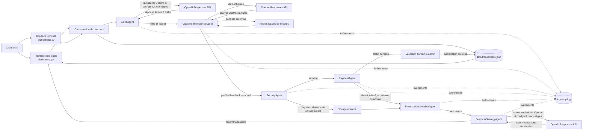

# Architecture multi-agents

## Vue d'ensemble

## Responsabilités et échanges

| Agent | Entrée | Traitement | Sortie transmise |
|---|---|---|---|
| `SalesAgent` | Questions et réponse d'intérêt | Présente l'offre; réponses ancrées dans l'offre par OpenAI si configuré, sinon règles locales | Réponse, prix de démonstration et statut d'intérêt |
| `CustomerIntelligenceAgent` | Niveau d'expérience et commentaire fictif | Analyse structurée via OpenAI Responses API si configurée; sinon règles locales | Profil client structuré, résumé et indication du mode d'analyse |
| `SecurityAgent` | Intérêt, commentaire, consentement et montant | Recherche des entrées suspectes, contrôle du consentement et du montant | Autorisation ou blocage avec alertes |
| `PaymentAgent` | Montant autorisé et choix de démonstration | Simule un résultat | `simulated_success`, `refused`, `pending` ou `cancelled` |
| `FinancialDataAnalystAgent` | Historique de parcours sauvegardés | Calcule volumes, conversion, revenus fictifs, statuts, objections et alertes | Indicateurs utilisés par le dashboard et l'agent stratégie |
| `BusinessStrategyAgent` | Indicateurs agrégés et recommandations de base | Génère des recommandations avec OpenAI si configuré, sinon règles locales | Recommandations commerciales fondées sur les métriques |

Le mode web fait avancer le client étape par étape; `orchestrator.py` propose aussi un mode terminal. Les deux modes utilisent les mêmes classes d'agents, des résultats structurés, le fichier JSON et les journaux. Pour un paiement `pending`, l'administrateur passe par `/admin` et choisit d'approuver ou de refuser. Aucun paiement réel n'est lancé.

## Sécurité, traçabilité et limites

- Les données du prototype sont fictives; le formulaire ne demande pas de données de carte.
- Le contrôle bloque certaines formulations de prompt injection, vérifie le consentement et limite le montant de démonstration.
- Les paiements en attente requièrent une décision humaine avec un PIN de démonstration configurable.
- Les événements enregistrent l'agent, l'action, le statut et les alertes sans recopier le texte brut dans la piste d'événements.
- Les réponses de vente, l'analyse client et les recommandations stratégiques peuvent utiliser un LLM via l'API OpenAI; le mode règles reste disponible sans clé ou si l'API échoue. Les calculs financiers, les contrôles de sécurité et le paiement restent déterministes.
- Seuls des commentaires fictifs doivent être envoyés à l'API; ne pas transmettre de données personnelles ou bancaires.
- Les journaux JSON locaux conviennent à une démonstration sur une seule machine, pas à un déploiement multi-utilisateur ou de production.
